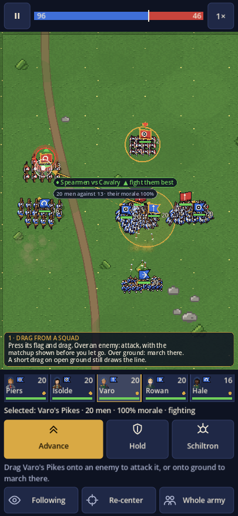
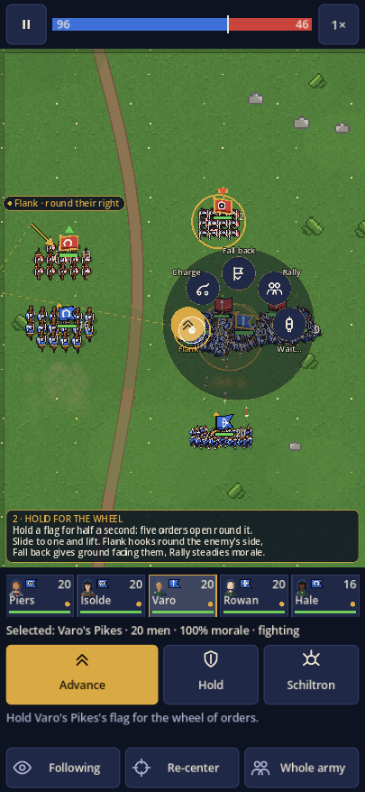
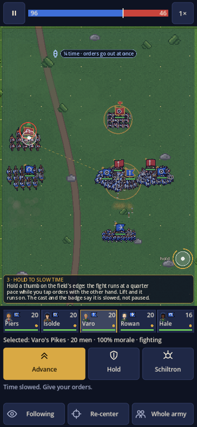

# Battle controls: three ways to give an order

Three controls for the fight itself, beyond the swipe that forms a line. Each mockup is
the real battle screen a few seconds into a field battle (seed 77, Varo's Pikes selected),
with the gesture drawn over it in the game's own palette. The dark strip above the cards
is the mockup's caption, not part of the screen.

| | |
|---|---|
|  |  |
|  | |

## 1. Drag from a squad

Press a squad's flag and drag. The thread follows the finger from the men. Over an enemy
flag the target rings red and a pill shows the matchup before the finger lifts: the two
troop types, the counter arrow (▲ fight them best, ▼ they have the edge, · an even fight),
then the numbers and the enemy's morale. Lift to attack. Over open ground: march there.

What stays: a tap still selects, and a drag that starts on open ground still draws the
line. Only a drag that starts on a flag becomes an order.

Sim: nothing new. Screen: `_press_on_flag`, the thread and ring in `_draw_line_order`'s
place, the pill from `Troops.COUNTERED_BY`.

## 2. Hold for the wheel

Hold a flag for half a second: five orders fan out over it. Slide to one and lift.

- **Flank**: hook round the enemy's nearer side and hit them from behind. The route is
  drawn on the field while the petal is lit.
- **Charge**: cavalry only; the ability on the card, here under the thumb.
- **Fall back**: give ground away from the nearest enemy, facing them, for a short
  distance, then hold.
- **Rally**: the captain steadies the men: morale back toward its floor, at the cost of
  a cooldown and the squad standing still while it happens.
- **Wait…**: hold now, and charge the moment the enemy next to them engages.

Sim: `order_flank` (a two-leg move using the existing steering), `order_fall_back`,
`rally` (morale, cooldown), and a `wait_then_charge` trigger. Screen: the wheel, the
lit petal's preview, and a bark from the captain when the order lands.

## 3. Hold to slow time

Hold a thumb on the field's edge: the fight runs at a quarter pace while the other hand
taps orders. Lift and it runs on. The field takes a cool cast and a badge under the
ticker says it is slowed, not paused. Orders given while slowed go out at once.

Sim: nothing new; it is the screen's `speed` and the `_slow` pace that already carries
the captain-down moment. Screen: an edge zone on the field (right or left, by handedness
setting), the cast, the badge, and the speed button reading ¼× while held.

## As built (1 and 3)

- **Drag from a squad.** A press on your own standard picks the squad up; a drag from
  anywhere else still draws the line. The card sits above the finger (below it near the
  top of the field) and names the troop types in each side's own words. Letting go over
  your own squad is a tap. Before the battle the same drag moves the one squad within
  the deploy zone. Screen: `_begin_press`/`_move_press`/`_end_press`, `_drop_target`,
  `_drop_squad`, `_draw_carry`, `_draw_carry_card`, `_matchup`.
- **Hold to slow time.** The handle is a fixed hourglass tab on the right edge, low on
  the field, rather than the whole edge, so taps on squads near the edge still land.
  Held, the sim steps at a quarter of real time whatever the speed button says, and the
  button reads ¼×. Godot only turns the first finger into mouse events, so while the
  handle is held a second finger's touch is read from the touch events and runs the same
  tap or drag. Pausing, the storm plan or the battle's end lets go of it. No handedness
  setting yet.
- Tests: `battle_controls_tests.gd` carries a squad onto an enemy and onto ground,
  checks a drag from open ground still draws a line, the matchup words, the quarter
  pace at 2×, a second finger's order while held, and release on pause.

## Order of work

1 and 3 are screen-only and small. 2 needs four small sim additions and a balance
check (Fall back and Rally in the AI's hands as well as the player's).
