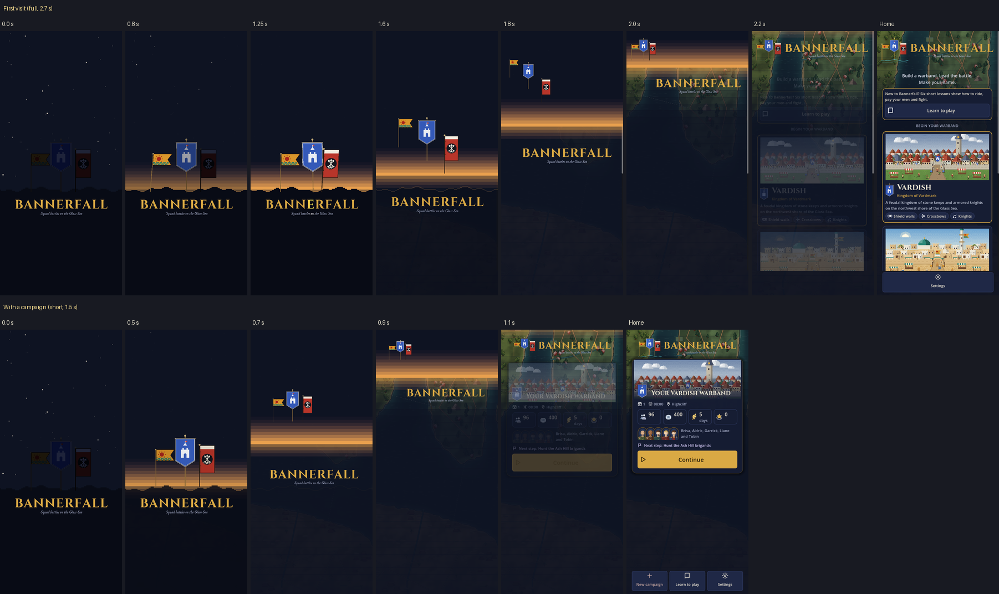
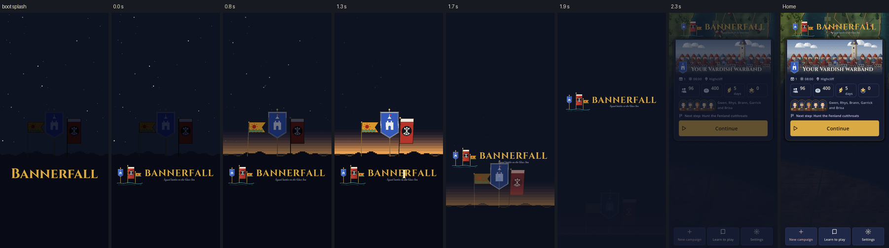

# The opening: what's wrong with it and what to do

**As built (2026-11-10).** All four stages are in: the reordered mark (`assets/branding/wordmark.svg`,
`tools/render_wordmark.gd`, `scripts/ui/wordmark.gd`), the splash rendered once from the new
first frame with its guard (`assets/splash.json`, `--check`), the full and short timelines,
the glint's shimmer (`tools/opening_sfx.py`), and the banners flying into the mark.
`tests/opening_tests.gd` checks all of it.

Where the build differs from the plan below:

- **The banners fly to Home's mark, not to the moving title,** on their own span (`fly`)
  a little ahead of the title's rise (`rise`). Chasing the rising title, they crossed the
  name mid-flight; this way they keep above it and land beside it. The tests step through
  both openings and fail if a banner or the dawn ever overlaps the name's ink.
- **The night ends at the horizon.** Lifting the whole screen of night showed the dawn at
  the top and a second warm band at the bottom, with night between. Now the sky stops at
  the ridge line, a glow lies under the horizon behind the ridge, and when the ridge fades
  Home shows beneath it; the night then lifts with the dawn as its lower edge.
- **The ridge fades in place** rather than sinking, so it never moves past the name.
- **The painted banners take over after the title has stopped** (over 0.12 s), and Home's
  own title is shown once the night has lifted from over it, so nothing doubles.
- **The mark** keeps the name and tagline as they were, moved left to sit by the banners;
  the image is now 1512 by 360. The banner cluster is exactly the ridge's (Vardmark's
  gonfalon is as tall as the nobori); the app icon, a single flag, is unchanged.

**Decided (2026-11-10):**
- **One set of banners.** The three on the ridge become the wordmark's three.
- **Vardmark in the middle.** The ridge keeps its order (Kharzan, Vardmark, Ryumon) and the
  wordmark is redrawn to match it.
- **A short opening when there is a campaign.** A first visit gets the full one.

## How it plays now

Frames captured from the running game (Godot 4.7, a 9:19.5 phone, a campaign under way). A
4:3 tablet and a first visit show the same things.

| Seconds | What happens |
|---|---|
| 0.0–0.3 | The first frame holds. |
| 0.25–1.3 | Dawn rises in stepped bands; the banners light 0.15 s apart and sway. |
| 0.95–1.55 | The glint crosses the title. |
| 1.35–1.95 | The land slides down 35% of the screen and fades. |
| 1.55–2.25 | The title shrinks and rises to its place on Home. |
| 1.95–2.75 | The night fades off Home, all of it at once. |

## What's wrong

1. **The splash is not the first frame.** The splash has the word alone, in Cinzel, centred.
   The opening's first frame has the painted wordmark: three small banners, a line of sea,
   the name in another face, and the tagline. So every launch starts with a jump, which is
   the one thing the splash was built to avoid. The wordmark came to Home after the splash
   was rendered, and the render tool builds its own stand-in title, so nothing noticed. The
   test checks the splash's size, shape and corner colour, never what is in it.
2. **Six banners.** The wordmark has its own three banners, so a second, smaller set stands
   under the three on the ridge, in a different order (ridge: Kharzan, Vardmark, Ryumon;
   wordmark: Vardmark, Ryumon, Kharzan).
3. **The glint is broken.** It shows the hidden Cinzel label in pale gold through a 36px
   slit. Over the wordmark, which is set in another face and has banners where the label has
   its first letter, that reads as a stray pale stroke passing through the name (see 1.3 s).
4. **The land falls through the title.** At 1.7 s the fading banners and the dawn band are
   sliding down across the wordmark as it rises. And the dawn that has just come up goes
   down again.
5. **It goes dark in the middle.** At 1.9 s the screen is flat night with a small wordmark
   in flight. The story reads night, dawn, night, Home. The dawn never reaches Home, though
   Home is the Glass Sea at dawn (`title.gd` lights its map with `DAWN`).
6. **Home arrives as one cross-fade.** Map, title, card and buttons at the same moment.
   Home's own 0.35 s fade-in is spent under the opening where nobody sees it.
7. **It is silent.** No cue marks the dawn or the title. The music starts when Home is
   built and fades in over 1.4 s, timed to nothing.
8. **A tap makes a cut.** `hurry()` jumps to 1.35 s, so the dawn and the banners snap to
   full before the fast finish.
9. **Reduced motion gets a hard cut** from the splash to Home. A plain fade is not motion.
10. **The same 2.75 s every launch,** for someone opening the game to carry on a campaign.

## What to build

The idea stays: night on the ridge, dawn, the title, Home. Four steps, in this order. The
mark comes first because the splash's picture depends on it: done this way the splash is
rendered once, in Stage 1, and never again.

### Stage 0: the mark, in the ridge's order (small)

The wordmark is a PNG with no source on `main`. Its source is `assets/branding/wordmark.svg`
on the `app-logo` branch. Godot rasterizes that SVG to the committed PNG within a few levels
per pixel (its letters are already paths, not text), so the mark can be rebuilt in the repo.

- **Bring `wordmark.svg` to `main`** and give its three banner groups the ridge's layout:
  Kharzan on the left, Vardmark in the middle on the tallest pole, Ryumon on the right, by
  the name. The banners' relative sizes and positions are the ridge's `BANNERS` rects scaled
  down, so the cluster on the ridge and the cluster in the mark are the same picture at two
  sizes. Vardmark's gonfalon is smaller than Ryumon's nobori; it grows to the nobori's
  height so the middle reads as the centre. The line of sea and the name stay where they
  are.
- **One layout, written once.** The three rects move from `opening.gd` to the shared
  wordmark script (below); `opening.gd` reads them from there. The SVG is laid out by hand
  to match them, and a test checks the banner regions of the rendered PNG against the rects
  (each banner's opaque bounds, within a few pixels).
- **`tools/render_wordmark.gd`** renders the SVG to `assets/branding/wordmark.png` with
  Godot's `Image.load_svg_from_buffer`, as `render_splash.gd` does for the splash. No new
  tool to install.
- **Two regions of one image.** The mark is shown as two `AtlasTexture` regions: the banners
  with their sea, and the name with its tagline. At rest on Home they sit exactly where the
  whole image sat, so Home looks the same. The opening moves them apart.

The app icon is a single flag and is not affected.

### Stage 1: make it true again (small)

Fixes, and the first frame as it will stay.

- **One title, built in one place.** Move `title.gd`'s `_title()` and `_wordmark()` to
  `scripts/ui/wordmark.gd`. Home, the opening and the render tool all build the title from
  it. The tool's stand-in goes.
- **The first frame, for good.** The three banners on the ridge, at night; under the ridge,
  the name and tagline (the mark's name region) at the splash's size. No small banners: the
  mark's banner region is hidden at t = 0. Until Stage 3, it fades in beside the name as
  the title rises.
- **Re-render the splash** from that frame.
- **A guard that runs headless.** The render tool writes `assets/splash.json` beside the
  image: the MD5 of `wordmark.png`, and where the title and each banner sit in the box at
  t = 0. The test builds the opening at the box's size, compares those rects, and compares
  the MD5. That catches exactly what happened here (the title changed, the splash didn't).
  Pixels can't be compared headless, so the tool also takes `--check`: render, compare with
  the committed image, fail above a small mean error. Run it under xvfb when the opening
  changes.
- **The glint, done on the picture.** A clipped copy of the name region, modulated pale,
  through the slit. It then brightens the letters that are there.
- **The land leaves without crossing the title.** It sinks 8% of the box, not 35%, and has
  faded before the title starts to move.
- **A tap never cuts.** `hurry()` keeps `t` where it is and raises the rate, so the rest
  plays through in about 0.4 s.
- **Reduced motion:** the opening's first frame fades off Home over 0.25 s. Nothing moves.

### Stage 2: the dawn opens onto Home, full and short (medium)

The second half is rebuilt so the light that rises behind the ridge is the light Home is in.
The opening's times become data: two timelines (`FULL`, `SHORT`) of named spans, chosen in
`setup()`. `GameState.has_campaign()` picks `SHORT`; a first visit, and a launch whose
autosave couldn't load (Home's "stranded" card), get `FULL`. Both start on the same first
frame, because the engine shows the splash before the game knows which it will be.

**Full** (first visit), 2.7 s:

| Seconds | What happens |
|---|---|
| 0.0–0.25 | Hold: the splash, exactly. This also covers a slow first frame. |
| 0.25–1.2 | Dawn. The stars go out from the horizon upward. The banners catch the light left to right, 0.22 s apart, each a little over-bright for a moment; a gust follows the light along the ridge, so each banner starts to sway as it is lit. |
| 1.0–1.5 | The glint crosses the name. |
| 1.5–2.3 | The night lifts from the horizon upward, in the same 18px steps as the dawn bands, with a warm edge. Home's map shows first, under the dawn. The ridge sinks and darkens out below the lifting edge. The title rises ahead of that edge to its place on Home. |
| 2.1–2.7 | Home arrives in order: the card rises 24px and fades in, then the bottom row. Home's own column fade waits for this, not for `_ready`. |

**Short** (a campaign under way), 1.5 s:

| Seconds | What happens |
|---|---|
| 0.0–0.15 | Hold: the splash. |
| 0.15–0.6 | Dawn, quickly. All three banners light together, Vardmark a beat ahead; they sway. |
| 0.5–1.1 | The night lifts and the title rises, as in the full one. |
| 1.0–1.5 | The campaign card rises, then the bottom row. |

No glint, no birds. Taps reach Home at about 1.2 s.

**Both:**
- No frame is flat night after the hold. That is the test for point 5.
- Taps reach Home when the card is up, not when the last fade ends.
- The night overlay is drawn as bands with their own alpha: no shader, safe on GL
  Compatibility, a few dozen rectangles a frame.

**Sound.**
- Full: `birds`, quietly, from 0.3 s, fading under the title music. One short rising cue as
  the glint crosses. There is no fitting sound in `assets/audio/sfx` (`horn` and `bell` are
  battle and town); make one with `tools/battle_sfx.py` or `tools/music.py`, and add its
  level to `sfx_levels.gd`.
- Short: the camp's fire comes up under the dawn, as Home already asks for
  (`Sound.set_loop("camp")`); no other cue.
- Both: `Sound.haptic()` once, when the title lands. The music (title, or your realm's camp
  tune) reaches full as the title lands: give the opening the 1.4 s fade's start, or hold
  `play_music` until the right moment. Try both by ear.

### Stage 3: the banners become the mark (medium)

The three on the ridge fly into the mark. Because Stage 0 made the mark's cluster the
ridge's cluster scaled down, this is one move, not three crossing paths.

- **Full,** 1.5–2.2 s: the banners still and stop swaying as they lift off the ridge, then
  shrink and fly as one group to the mark's banner region beside the name, each 0.04 s
  after the one on its left, so they arrive left to right. Over the last 0.15 s each
  cross-fades from the drawn banner (`Heraldry.realm_banner`) to the painted one. The name
  rises with them to its place; the mark is whole as it reaches Home.
- **Short:** the same move, in 0.5–1.1 s, all three together.
- The line of sea under the mark's banners fades in as they land.
- **How:** each piece has a start rect in the box and an end rect taken from Home's own
  wordmark regions, and moves between them. Nothing is measured by eye.
- Stage 1's interim fade-in of the mark's banners goes. The splash does not change.

## Files

| File | Change |
|---|---|
| `assets/branding/wordmark.svg` (from `app-logo`) | Banners in the ridge's order and layout. |
| `assets/branding/wordmark.png` | Re-rendered from the SVG. |
| `tools/render_wordmark.gd` (new) | Renders the SVG to the PNG. |
| `scripts/ui/wordmark.gd` (new) | The title label and wordmark, shared; the banner layout; the two regions. |
| `scripts/menu/opening.gd` | The two timelines, the glint, the lifting night, `hurry()`, the cues, the gathering. |
| `scripts/menu/title.gd` | Uses the shared title; Home's column waits for the opening; reduced-motion fade. |
| `tools/render_splash.gd` | Builds the real title; writes `splash.json`; `--check`. |
| `assets/splash.png`, `assets/splash.json` | Rendered once, in Stage 1. |
| `scripts/audio/sound.gd`, `scripts/data/sfx_levels.gd`, one new sfx | The opening's cue. |
| `tests/opening_tests.gd` | The guard; the mark's banners match the ridge's layout; no dark frame; the land never overlaps the title; a tap doesn't move `t`; taps pass at the card; full on a first visit, short with a campaign, full when stranded; reduced motion fades. |
| `README.md` | The opening's paragraph, and the render commands. |

## Done when

- The splash and frame 0 match on a phone, a tablet and a desktop window: `--check` passes,
  and a screen recording of a cold start shows no jump, with and without a campaign.
- Six banners never show at once; Vardmark is in the middle on the ridge and in the mark.
- No frame after the hold is a flat colour.
- Nothing crosses the title at any time.
- With a campaign it is done in 1.5 s; a first visit takes 2.7 s.
- A tap at any moment ends it in under half a second with no cut.
- With reduced motion nothing moves, and nothing cuts.
- `tests/opening_tests.gd`, `menu_tests.gd`, `presentation_tests.gd` and
  `screen_width_tests.gd` pass.
- Checked on a real phone, cold start, sound on: the cue lands with the glint.

## Not in this plan

Home's wordmark is hard to read over the map once the opening has gone (brass on green,
under a 25% veil). That is Home's layout, not the opening, and wants its own look.
