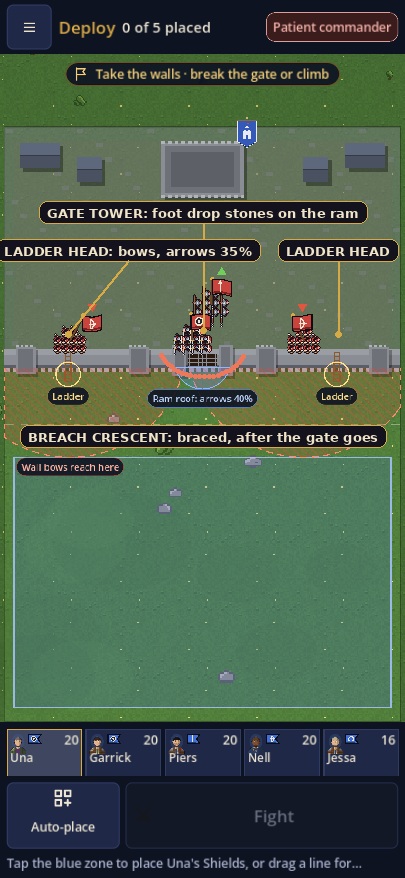

# Bannerfall: the siege defence plan

- **Date:** 2026-11-05
- **Status:** proposed. Nothing here is built. Mockups are in `docs/mockups/`; today's deploy is `siege-deploy-today.png`.
- **Goal:** turn a castle battle from a scrum at the gate into a defence with places and
  jobs: the wall walk, the gate tower, the ladder heads, the breach. The garrison's
  numbers already hold; what it lacks is anything to *do* with a wall.

## What happens today, measured

`tests/_partial_siegeprobe.gd` fought eight seeded AI-vs-AI assaults on a castle each
way. "Even" is five companies against five (two swords, spears, two bows each side);
"half again" adds a sword and a spear company to the attacker.

| Assault | Attacker wins | Gate breaks at | Attacker loses | Garrison loses |
| --- | --- | --- | --- | --- |
| Even, 5 v 5 | 1 of 8 | 51–59 s (one at 96 s) | 69 of 96 | 37 of 99 |
| Half again, 7 v 5 | 7 of 8 | 49–52 s | 66 of 134 | 62 of 99 |

So the walls win the numbers. The problem is the picture, and it is the one the user
described: both sides crowd the wall.

**The attackers pile on the gate, bows included.** At 20 s, 55 of the 87 attackers stand
within 90 px of the gate. At 40 s every one of the 85 left stands within 80 px of the
wall, both archer companies among them, standing in the press with their bows. *Storm*
is `order_all(advance)`, and nothing tells a bow company in a siege to stop at bow range.

**The garrison crowds the inside of the gate and fights through it.** The spear company
posted 93 px behind the wall walks to 23 px behind it and fights the ram crew through the
shut gate: the gate is two cells (60 px) wide, the men on each side stand 20 px from its
centre line, and a spear reaches 24 px. The bows leave the wall walk for the gate the
same way (one company drifts from x = 219 to 258). A holding squad looks for a foe within
`reach + ENGAGE_RANGE + 50` and the wall is no obstacle to that search. Meanwhile the two
sword companies, 40 of the garrison's 99 men, stand idle 118 px back until the breach.

**The ladders go unused.** No attacker went over a ladder in any even assault. The storm
plan sends a foot company to a ladder only if it starts nearer the ladder than the gate,
and auto-deploy puts the foot in the middle.

**After the breach, the garrison throws its wall away.** The commander's siege rule is
"hold until the gate gives"; when it gives, the ordinary rule takes over and every
holding squad is told to advance. The garrison streams out through the gate into the
attackers' mass. At 90 s there are 34 garrison men and 37 attackers inside 90 px of the
gate, a blob straddling the wall; by the end two garrison companies stand outside it
(y = 517 and 537 against a wall at 495).

The player's own garrison, when they hold a fief, gets the same deploy (bows on the walk,
foot in a row against the gate) and one word of guidance: "Hold the gate".

## The idea

A wall is useful because it has a *top* and a *hole*. Give the defenders the top (the
walk, the gate tower, the ladder heads) and make the hole a place to be waited for (the
breach crescent). Stop the things that make the wall vanish (fighting through a shut
gate, sallying at the breach), and make the attacker use the wall's weaknesses properly
(bows stand off and shoot the walk; the ladders get used). The numbers can stay where
they are; the tests pin them. What changes is where the men stand and why.

Everything below is in `battle_sim.gd` and `commander_ai.gd`, so auto-resolve and the
map are untouched until the balance run at the end says the wall multiplier needs a
nudge.

## Package A: a shut gate is a door

While `gate_hp > 0`, nobody on one side of the wall row may target, engage or strike
anybody on the other, with one exception: a man on a ladder cell and the defenders at its
head (Package B3). Concretely `_pick_target`, the `nearest_enemy_squad` calls that set
`focus` and `engaged`, and `_strike` all skip across-the-wall pairs.

Expected: before the breach, melee kills are zero on both sides away from the ladders;
the spear company stays at its post; the ram crew takes only arrows and stones. The ram
itself is untouched (gate 750 / 600 blows, one blow a second a man).

## Package B: posts on the wall

Three posts, all on the row of cells just inside the wall (the drawn wall walk).

1. **The walk.** `WALL_COVER` (75 px, arrows at 50%) narrows to the walk itself
   (|y − wall_y| < 45) and tightens to 35%: crenellations. The courtyard behind it loses
   the cover it has today, so the walk is the place to be. Bows on the walk shoot with
   the same range multiplier a hill gives (`TerrainRules.height_range_mult`), about +20%.
2. **The gate tower.** Foot (not bows) on the walk within 50 px of the gate's centre line
   drop stones: each man deals `STONE_DAMAGE` (first guess 6 a second, about half a sword
   blow) spread over the attackers within `GATE_REACH`, with the ram roof taking its 40%
   as it does for arrows. Twenty men on the tower kill roughly a rammer every five seconds,
   about ten over the fifty seconds the gate takes to break: a real cost, not a decisive
   one. The attacker's answers are arrows on the tower (now at 35%) or clearing it by the
   ladders. `STONE_DAMAGE` is the main tuning knob of the whole plan.
3. **The ladder heads.** A man topping a ladder (on the ladder cell, inside half) fights
   at half power and takes double from defenders on the walk within 30 px of the ladder
   head: thrown down. A held head slows the climb (`LADDER_PACE` 0.45 → 0.25 while a
   defender stands within 30 px). An unheld ladder is exactly as it is today.

## Package C: hold the breach

When the gate breaks, a defending commander forms the foot in a crescent 70 px behind the
gate (centre on the gate line, two flanks at ±70 px and 40 px nearer the wall, facing the
gate), ordered to hold, so they brace. The bows stay on the walk shooting down into the
gate mouth, still under cover. The crescent is `breach_posts()` in the sim, so the screen
can draw it and the player's garrison can take it with one tap. The garrison sallies
(advance all) only once the attackers waver or rout, by the commander's existing
`_winning`, never while they hold the field.

Expected: the fight after the breach stays inside the walls, sixty pixels wide, into
braced spears with `BRACE_POWER`; no garrison company's centre goes outside the wall
before the attackers rout.

## Package D: the storm uses the wall's weaknesses

- Ranged squads in a storm stand off: an advancing bow company in a siege, while the gate
  holds, stops at bow range of the wall and shoots the walk (a new `stand_off` on the
  squad, set by `order_storm`, cleared at the breach or by any other order). The player's
  storm plan text gains "the bows shoot the walls".
- The AI attacker's plan: with three or more foot companies, one goes to each ladder (the
  two nearest the flanks), the rest to the ram; with fewer, as today. So ladder fights
  happen in most assaults, which is what the ladder heads are for.

Expected: at 40 s no more than ten attacking archers within 80 px of the wall; a man over
a ladder in at least half of the half-again assaults.

## Package E: deployment and the player's garrison

Garrison auto-deploy: bows on the walk over the ladders (today ±200 px from the gate,
x = 220 / 620; the ladders are at 135 / 705, so ±245), the first foot company on the gate
tower, the spears in the crescent, any further foot at a ladder head. A player holding
their fief gets the same from Auto-place, and the walk shows its posts during deploy:



(`docs/mockups/siege-posts.png`: the real deploy screen with the garrison
placed at the proposed posts; the crescent and labels are drawn on.)

The defender's command bar, mirroring the attacker's *Storm*:

```
 Gate holds                                  Gate broken
┌──────────┬──────────┬──────────┐          ┌──────────┬──────────┬──────────┐
│ Man the  │  Hold    │  Fire!   │          │ Hold the │  Sally   │  Fire!   │
│  walls   │          │          │          │  breach  │          │          │
└──────────┴──────────┴──────────┘          └──────────┴──────────┴──────────┘
 bows to the walk, foot to the               foot to the crescent, braced;
 tower and ladder heads                      Sally = advance all
```

The objective line reads "Man the walls" while the gate holds and "Hold the breach"
after, instead of "Hold the gate" for both.

## Package F: nerve behind stone (later)

Garrison squads on the walk or in the crescent take morale shocks at half while the gate
holds. Not in the first build: the balance run decides whether the walls need it.

## Package G: the screen

- Deploy markers on the walk for the defender: "Gate tower" over the gate (the ladders
  already have their circles), the crescent as a dotted line "Hold the breach here".
- Stones: small grey dots falling from the gatehouse onto the ram, with the existing
  dust burst; a "stones" badge on the ram company's chip.
- Callouts, in the existing tiers: "Stones from the gatehouse!", "Thrown from the
  ladder!" (first_down, the mirror of first_over), "They hold the breach" / "Your men hold
  the breach".
- The attacker's chips: a bow company standing off reads "shooting the walls".

## What does not change

- The gate's strength and the ram's pace.
- An unheld ladder.
- Field battles: none of this runs outside `OBJECTIVE_SIEGE`; the boundary test checks a
  seeded field battle ends the same.
- Auto-resolve and the map, unless the balance run moves the sim's rates.

## Tests

Added to `tests/siege_tests.gd`:

- **A.** In even assaults seeded 1–4, no melee kills on either side before the breach
  away from the ladder cells.
- **B1.** A man on the walk takes 35% of an arrow from below; a man 60 px behind the walk
  takes all of it.
- **B2.** A foot company on the gate tower kills rammers over a fifty-second batter and
  the roof halves it; bows on the tower drop nothing; foot 60 px from the gate drop nothing.
- **B3.** A held ladder head: the climb takes about twice as long and the first man over
  is killed more often than not across eight seeds; an unheld head is as today.
- **C.** After the breach the garrison foot's centres stay inside the wall and within
  110 px of the gate until the attackers rout; at least 70% of the attacker's losses after
  the breach fall within 100 px inside the gate.
- **D.** Attacking archers' mean distance to the wall over the first 40 s is at least
  150 px; an AI attacker with three foot companies sends one to each ladder; a man over a
  ladder in at least half of the half-again assaults.
- **E.** Auto-deploy puts bows over the ladders, a foot company on the gate tower and the
  spears in the crescent, for the AI garrison and for a player holding their fief.
- **Balance**, kept where it is: an even assault fails at least 3 of 4 (4 of 4 is fine),
  half again breaks in at least 3 of 4, twice always; an even assault on walls the player
  holds fails at least 3 of 4. Then the full balance run.

## Order and sizes

1. **A + D**, the two that change the picture most, both small. Measure again.
2. **E + C**, the posts and the breach: deploy, `breach_posts()`, the garrison AI.
   Medium.
3. **B**, the new mechanics: walk cover, stones, ladder heads. Medium, and the tuning.
4. **G**, the screen. Medium.
5. The balance run, `STONE_DAMAGE` tuning, and whether auto-resolve's ×1.6 / ×1.4 wall
   multiplier still matches the sim.

Each step gets its screenshots next to today's in `scratchpad/siege_now/` before it is
called done.

## Open questions

- Stones need a foot company to stand on the tower rather than in the crescent: is one
  company on the tower and the rest below the right default, or should the tower be a
  choice the player makes (the "Man the walls" order puts one there; a tap moves it)?
- Should the crescent brace bonus be visible as a chip ("braced at the breach") so the
  player sees why the attackers are dying at the gate?
- Sally as a button invites the mistake the AI makes today. Keep it, with a warning hint
  when the attackers still outnumber the men inside?
