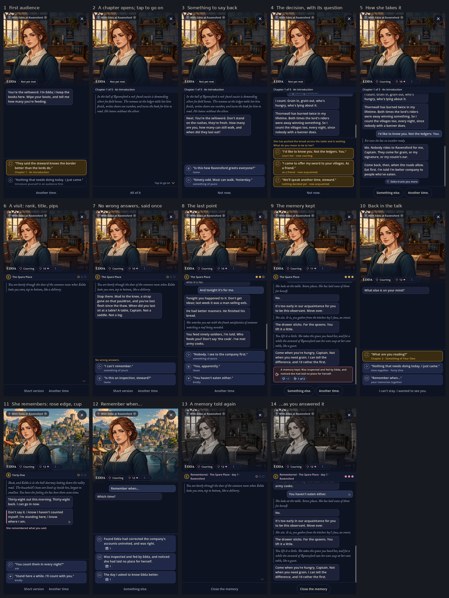
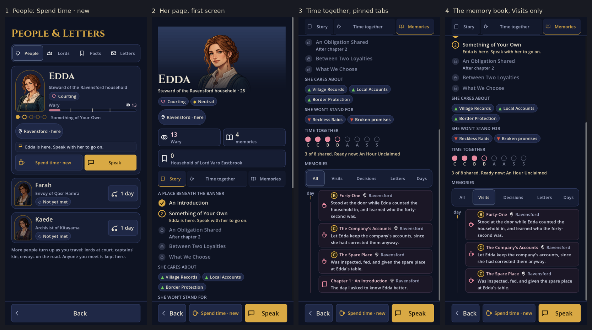
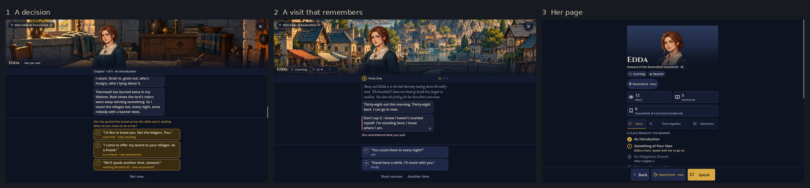
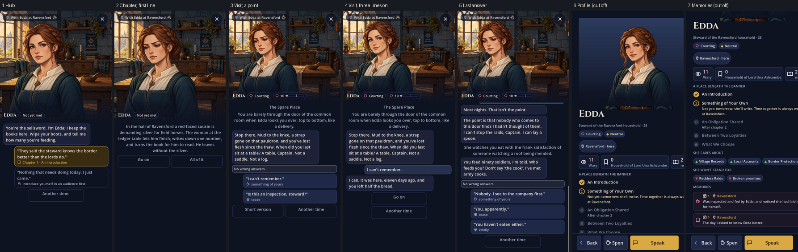
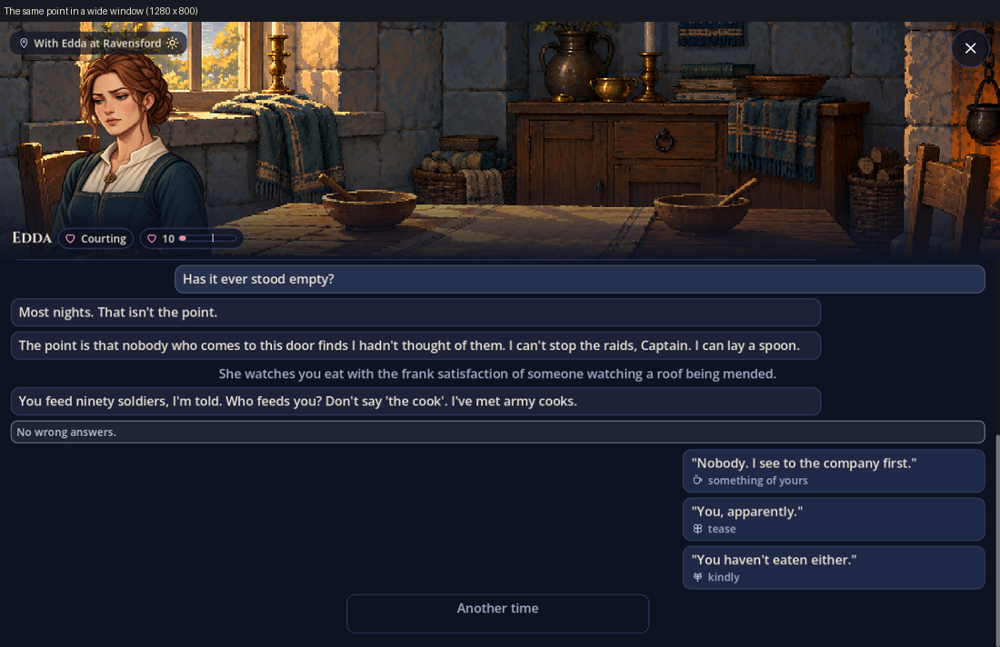

# The talk screen and the People pages: what was wrong, and what was built

It covers the screens the romance dialogue is read on: the talk itself
(`scripts/ui/talk_view.gd`, `scripts/menu/romance_talk.gd`), and the People list, a
person's profile and her memory book (`scripts/menu/people.gd`). Sizes are in the game's
canvas units: the screen is 720 wide on a phone.

**Status: built.** Everything under "What to build" is in, with three decisions made
along the way:

1. **No "Go on" button at all.** Between lines there is nothing to press: a small chevron
   breathes at the foot of the conversation and a tap anywhere (or Enter) brings the next
   line. Until you have gone on once, the chevron says "Tap to go on".
2. **The small cup is in.** An answer she will keep carries a small cup on your own
   bubble as you say it, with no words; the same cup, with a rose edge, marks her line
   when it comes back.
3. **Nothing shows what she knows about you.** The profile has no list of your kept
   answers: being remembered stays a surprise.

## How they look now

A first audience, a visit from its first line to its keepsake, a later visit that
remembers an earlier one, and a memory told again:



A person's page: the first screen, time together, and the memory book with a filter on:



The talk and the profile in a wide window:



## How they looked before

Captured from the running game on a 9:19.5 phone.



And one point of a visit in a wide window:



## What was wrong

### A bug first: the profile runs off the screen

Frames 6 and 7. A person's profile is laid out **894 wide on a 720 screen**, so the right
174 units are cut off: sentences end mid-word, the third stat tile and the "she cares
about" chips are clipped, memory text is cut, and the bottom bar reads "Spen" for "Spend
time".

- **Cause:** the row of stat tiles (`Tile_*`, a `GridContainer`) has a minimum width of
  798, because the house tile's label ("Household of Lord Una Ashcombe") does not wrap.
  The page column takes that width, and everything in it follows.
- "Spen" is cut in a wide window too, where the page itself fits: the bottom bar's middle
  button is too narrow for its label at any width.
- No test opens a profile: `screen_width_tests.gd` visits the People tabs, not a person.

### The talk

1. **What you tap moves.** The replies sit directly under the last line, not at the bottom
   of the screen. "Go on" is at a different height after every line (frames 2 to 4), and
   the lower third of the screen is empty at the start of every scene. Once the text
   outgrows the space, the buttons are pushed off the bottom and the log has to scroll to
   bring them back.
2. **"Go on" is three big empty boxes.** Go on, Short version and Another time are each a
   full 80-high outlined button of equal weight, though a tap anywhere already continues.
   They are the loudest things on the screen and the least interesting.
3. **The text has half the screen.** The stage (her portrait and room) takes 46% in the hub
   and chapters, 38% in visits. Chapters are now scenes of six to ten lines; by the
   decision, her last line has scrolled under the nameplate (frame 5 shows a bubble cut
   in half at the top). The cut is a hard edge.
4. **Everything in the log weighs the same.** Narration is centred grey text, up to five
   lines of it, which is hard to read centred. Her bubbles, your bubbles, "No wrong
   answers." and the brass prompt are all rounded boxes of about the same size.
5. **"No wrong answers." three times a visit.** It is a full-width box at every point.
6. **A heart answer looks like any other.** All visit options are the same blue, with the
   kind of thing it is (ask, tease, from the heart) as small grey text under the words.
   The one option that only a courtship has is told apart by a 20-unit glyph.
7. **No sense of where you are.** A visit shows its title and nothing else: not its rank
   (C, B, A or S), not that there are three points and you are at the second. A chapter
   doesn't say which of five it is once you're in it.
8. **Being remembered is invisible.** When she brings up something you said in an earlier
   visit, the line looks like every other line. The feature that makes choices matter has
   no mark on the screen. Nor is there any sign, when you answer, that this is one she
   will keep.
9. **A memory told again looks like a visit.** Only the word "Remembered" before the title
   says otherwise.
10. **In a wide window it falls apart.** Her bubbles run 80% of a canvas about 2050 wide, one
    long line each; your answers are in the far right corner; the portrait is a small
    figure at the left of an enormous room. The talk has no column.

### The People pages

11. **The profile buries the memory book.** The portrait is 560 tall, so the name is at
    y = 626 and the memories begin about two screens down, under the stats, the chapter
    list, and two rows of chips.
12. **Memories are a flat list.** Each is an icon, a day, a place and a sentence. A visit
    doesn't show its rank or title; there is no way to see which of the eight visits are
    done, or what opens the next.
13. **Nothing shows what she knows about you.** She asks you why you took up the sword,
    how you carry your dead, a place you know by a private name. Your answers are saved
    and she uses them; nowhere can you see them.
14. **"Spend time" doesn't say whether there's anything new.** The button looks the same
    whether a visit is waiting, today's is spent, or all eight are done.

## What was built

### Stage 0: fix the profile (small)

- The stat tiles wrap (`Widgets.tile(..., wrap)`): trust and memories share a row, and the
  house, whose name can be long, has a row of its own.
- The bottom bar's buttons share the width by set ratios, and each one's words shrink to
  fit and then wrap (`_fit_bar`); a single word shrinks further instead of breaking. So
  "Spend time" is never cut, at any text size.
- `screen_width_tests.gd` opens each person's profile and her memories at 720, at normal
  and at 150% text, and checks that no control's right edge passes the screen's and that
  no button in the bar or the tabs shows only part of its words.

### Stage 1: a fixed tray, and a quieter way on (medium)

The screen becomes three bands that never move:

```
┌──────────────────────────────┐
│  stage: room, portrait       │  40% (hub, chapters) · 34% (visits)
│  EDDA  ♡ Courting  ♡ 10 ▬▬   │  nameplate, on the stage's lower edge
├──────────────────────────────┤
│░ fade ░░░░░░░░░░░░░░░░░░░░░░░│  24-unit fade, so lines leave softly
│  the log: scrolls            │
│  …her newest line            │
│                           ▾  │  continue cue, after the last line
├──────────────────────────────┤
│  tray: what you can say      │  pinned to the bottom, above the
│  ┌ ◉ "Is this an inspection…"│  safe-area inset; grows upward to
│  └ ◉ "I can't remember."     │  fit, to at most 55% of the screen
│  Short version · Another time│  footer: quiet text links
└──────────────────────────────┘
```

- **The tray is pinned to the bottom.** `_replies` leaves the scroll and becomes its own
  band; `_layout()` gives the log the space between stage and tray. The log scrolls to
  its end whenever the tray's height changes, so the newest line is always just above
  what you can say.
- **Between lines the tray is nearly empty.** No "Go on" button. A small chevron breathes
  at the foot of the conversation (still under Reduced motion), and a tap anywhere on the
  log or the stage continues, as does Enter or Space. The tray shows only the footer. In
  code a reply whose id is `continue` is never drawn as a button: it becomes the mark
  (`Reply_continue`), so tests and keyboard still have something to press.
- **The footer is text, not boxes:** "All of it", "Short version", "Another time" as quiet
  links on one row, each with an 80-high touch area but no outline. One row, at one
  height, for the whole scene.
- **The stage gives the text more room:** 40% in the hub and chapters, 34% in visits, and
  30% while the answers on offer would otherwise leave the conversation less than 240
  units (eased over 0.2 s; set at once under Reduced motion). The talk itself never has
  less than 150; past that the answers scroll inside the tray. The portrait keeps its
  face in frame at each size. Talks at the fire, weddings and dances keep their 46%.
- **A 24-unit fade** at the top of the log (a gradient over the scroll, not a shader).

### Stage 2: the log reads as a conversation (small)

- **Narration** is left-aligned in the letter face's italic (`Style.letter_font(true)`,
  already in the project), muted, with a 3-unit rule down its left side and no box.
  Her words stay in her bubble; yours in yours.
- **Prompts** ("What do you mean to be to her?", "Where will you marry?", "Raise your
  cup", the step that asks you to be sure) are a caption above the tray's answers, in
  brass, not a box in the log (`set_replies(replies, prompt)`). So is "No wrong
  answers.", shown once: at the first point of the first visit you ever have (kept with
  the tutorial hints, `Sound.mark_hint_seen`).
- **A visit's header** is one strip: the rank in a small round badge, the title, and a
  pip for each point, filled as you answer. `C · The Spare Place · ● ○ ○`. A chapter's:
  `Chapter 2 of 5 · Something of Your Own`.
- **A memory told again** is unmistakable: the room and her portrait lose most of their
  colour and a fifth of their light, the header strip reads "Remembered · The Spare
  Place · day 14 · Ravensford" in rose, and the footer's one link is "Close the memory".

### Stage 3: answers you can tell apart (small)

Each answer is a row: a 44-unit round badge with the kind's icon, then the words, with
the kind in small text under them.

| Kind | Fill | Edge | Badge |
|---|---|---|---|
| Talk (ask, tease, share, kindly, quietly, lend a hand) | raised blue, as now | rule | muted |
| From the heart | `2a1f26` | `Style.ROMANCE` | rose, heart |
| As a friend | raised blue | `Style.BRASS` at 60% | brass, sun |
| A decision | `3a2c10`, as now | `Style.BRASS` | brass, the decision's own |
| Locked | as now | as now | lock |

- The heart answer is last in the list and the only rose thing on the screen.
- Answers keep the 80 minimum height and wrap at 150% text; the badge stays top-aligned.

### Stage 4: being remembered, shown (small)

- **When she brings up something you said**, that line's bubble has a rose left edge and a
  small cup at its corner. The first time it ever happens, a one-line hint under it:
  "She remembered what you said." (once, with the tutorial hints).
  `PersonalConversations.paragraphs()` already knows which lines were conditional on a
  mark; `beats()` passes that on as `remembered: true`. Lines conditional only on the
  route, or on a visit being done, are not marked.
- **When your answer is one she will keep**, your bubble gets the same small cup, quietly,
  as it is said. No text, no sound: you learn what it means when it comes back.
  (`beats()` passes `kept: true` on your line when the option you chose has a `mark`.)

### Stage 5: the profile and the memory book (medium)

- **The portrait is 340 tall**, with her name and role set over its lower fade, so the
  first screen holds: portrait, name, status, where she is, and the stat tiles.
- **Three sections under it, with a sticky row of tabs:** Story · Time together ·
  Memories. A tap scrolls to the section; the tab follows as you scroll.
- **Time together** is new: eight pips in rank order, `C C B B A A S S`, each filled when
  that visit is done, the next one outlined. Under them one line says what opens it:
  "Tomorrow", "At Ravensford", "After commitment or friendship", or the visit's title
  with a "Spend time" button when it's ready.
- **What she knows about you is not shown.** The plan had your kept answers listed under
  the pips; it was decided against, so that being remembered stays a surprise. A test
  checks nothing of the kind is on the page.
- **Memories** are a timeline: a day marker down the left, entries grouped beside it.
  A visit shows its rank badge and title over the line of what you did; a decision its
  chapter; a letter its subject. A row of filters above: All · Visits · Decisions ·
  Letters · Days (ceremonies, dances, moves, and older notes). Changing the filter
  refills the book in place, so the page stays where it is.
- **"Spend time" says what's waiting**, on the list card and the profile's bottom bar:
  "Spend time · new" in brass when a visit is ready, plain otherwise; the line under the
  pips gives the reason when it's not ("It's late. Another day.").

### Stage 6: a column for wide windows (small)

- The log and the tray keep to `Style.COLUMN_MAX` (720), centred, as the menus do
  (`Page.cap_width`).
- The stage stays full width, but the portrait stands at the column's left edge and is
  sized by the stage's height, so on a wide window she is a figure in a room at the head
  of the column, not a small one in its corner.
- In landscape with the height under 900, the stage takes 34% at most.

## Files

| File | Change |
|---|---|
| `scripts/ui/talk_view.gd` | The three bands and `_layout()`; the tray; the footer links; the continue cue; the top fade; narration's style; answer rows with badges and kinds; the header strip; the column cap. |
| `scripts/menu/romance_talk.gd` | Prompts and "No wrong answers" as tray captions; the visit and chapter headers; the memory look; stage shares; which lines are remembered. |
| `scripts/data/personal_conversations.gd` | `beats()` marks remembered lines (`remembered`) and answers she will keep (`kept`). |
| `scripts/menu/people.gd` | The tile row and bottom bar (Stage 0); the shorter portrait; the tabs; Time together; the timeline and its filters; "Spend time · new". |
| `scripts/ui/widgets.gd` | A rank badge; a pip row; tiles that wrap. |
| `tests/screen_width_tests.gd` | Each profile and her memories, and the talk through a visit, at 720 and at 150% text; the talk in a wide window. Needs a window (`xvfb-run`). |
| `tests/talk_and_memories_tests.gd`, `personal_conversation_tests.gd` | The tray stays put between lines; no Go on button; the heart answer's look; the header's pips; remembered lines are marked and route lines aren't; the cup on kept answers; the profile's tabs, pips, timeline and filters, and that it shows nothing of what she knows. |

Bonds at the fire, the wedding and the dance are built on `TalkView` and have the tray,
the fade and the column with it; their prompts ("Your vow.", "Raise your cup", "Ask
someone to dance") moved from the log to the tray's caption (`scripts/menu/wedding.gd`,
`dance.gd`). Talking to lords has a layout of its own and is unchanged.

## Done when

All of these hold, and the tests named below check them.

- A profile fits a 720 screen at normal and 150% text, and a test says so.
- Reading a visit from first line to last, nothing you tap changes position except when
  answers appear, and they appear in the same place each time.
- The newest line is never cut by the nameplate, and never hidden behind the tray.
- A heart answer can be picked out without reading.
- A visit shows its rank and how far through it you are; a memory can't be mistaken for
  a new visit.
- When she brings up something you said, you can see that she did.
- From a person's profile, the memory book is one tap away, and the eight visits are on
  the page. What she knows about you is not.
- In a 1280 by 800 window, the talk reads in a 720 column.
- With Reduced motion nothing eases or pulses. Every answer is at least 80 high.
- `talk_and_memories_tests`, `personal_conversation_tests`, `presentation_tests`,
  `lord_conversation_tests`, `wedding_tests`, `gathering_tests`, `text_scale_tests` and
  (under `xvfb-run`) `screen_width_tests` pass.

## Order

Stage 0 is a bug and goes first. Stage 1 is the one that changes how the talk feels, and
everything after it sits in the tray it makes. Stages 2 to 4 are small and independent.
Stage 5 is the largest and touches only People. Stage 6 last.
